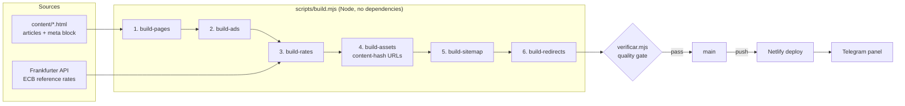

# cotacoesdemoedas.com

Portuguese-language currency-rates site for people sending money between Portugal and Brazil. Live at **[cotacoesdemoedas.com](https://cotacoesdemoedas.com)**.


> The source code is private and available on request.

The interesting part is not the page, it is the machinery around it: a **zero-dependency build pipeline**, a **quality gate** that fails the build on SEO and policy regressions, **scheduled publishing** driven by pull-request labels, and a **Telegram ops panel** built on Netlify Functions.

---

## Why it exists

The first version rendered exchange rates in the browser only, so crawlers saw "Loading..." instead of data, and the site was rejected by Google AdSense for low-value content. This project is the rebuild:

- exchange rates are **rendered at build time**, so they are in the HTML a crawler receives;
- every page is a **real URL** with one canonical address, instead of hash anchors on a single page;
- content is **first-hand** (own transfer receipts, multi-year ECB rate analysis) rather than generic explainers;
- everything is **checked automatically** before it ships.

## Architecture



Order matters: the sitemap and redirects read the page list written by step 1, the sitemap also uses the rate date from step 3, and step 4 must run after every write to HTML.

## Automation (GitHub Actions)

| Workflow | Trigger | What it does |
|---|---|---|
| `rates.yml` | Mon-Fri 16:15 UTC (after the ECB publishes), or manual | Runs the build and commits only if the rates changed. If Frankfurter is down the build exits without writing, so the site keeps the last good rate. |
| `publicar-agendados.yml` | Daily, or manual with a dry-run option | Merges any open PR labelled `publicar:YYYY-MM-DD` once that date (Lisbon time) arrives, rebuilds on top of current `main`, runs the verifier, then pushes. On conflict or failed check nothing is published. |

Scheduled publishing performs a real merge on `main` instead of "update branch, then merge", because GitHub refuses a `GITHUB_TOKEN` push that changes `.github/workflows/`. The rebuild runs before the push, so a PR that waited a week does not publish week-old rates.

## Quality gate

`scripts/verificar.mjs` runs after the build and exits non-zero if any check fails. It covers:

- no placeholder text left in served HTML;
- required, unique metadata on every page, and no accidental `noindex`;
- valid JSON-LD;
- internal links that point to pages that exist;
- scripts isolated and versioned by content hash;
- ad placement within policy, and a single consent surface with no tags loaded before it;
- affiliate links correctly disclosed;
- sitemap and `robots.txt` consistency;
- minimum word counts for guides, and no unwritten text.

The repository has no unit-test suite; this verifier is the safety net, and it runs inside the scheduled-publish workflow before every push.

## Telegram ops panel

Netlify Functions that report what is happening to the site. They use only free services (Netlify Functions, Netlify Blobs, the Telegram Bot API, the GitHub API) and Node's built-in `fetch`: no `package.json`, no install step, no change to the site build. A failure here can never affect the site, because the functions run only after a deploy is published.

| Message | When | Sent by |
|---|---|---|
| Preview ready (PR #n) | A pull request deploy preview is published | `deploy-succeeded.mjs` |
| Production deploy finished | Any published deploy: merge, daily rates, rebuild | `verificar-producao.mjs` (scheduled, every 5 min) |
| New page published | A new URL appears in `sitemap.xml` | `verificar-producao.mjs` |
| Deploy failed | A deploy does not finish | `deploy-failed.mjs` |

Design decisions worth calling out:

- **Idempotent, self-healing state.** The last announced deploy ID, the known sitemap URLs and the last error live in Netlify Blobs. State is only written after Telegram accepted the message, so a failed send is retried on the next run instead of being lost.
- **A minimal Blobs client** written with `fetch` only, exposing the same interface as the official package (`getStore`, `get`, `setJSON`), to keep the zero-dependency rule.
- **Debugged around a Cloudflare proxy.** The domain sits behind Cloudflare, and requests coming from Netlify's own servers get a 403, while `*.netlify.app` addresses go straight through. Production notices therefore use a scheduled function that runs inside the published deploy and reads the sitemap from the deploy permalink, which has identical content.

## Stack

| Area | Choice |
|---|---|
| Site | Static HTML/CSS/vanilla JS, generated at build time |
| Build | Node 20 scripts, ES modules, native `fetch`, no dependencies |
| Data | Frankfurter API (ECB reference rates), committed as `rates.json` as the last-known-good value |
| Hosting | Netlify (push-to-deploy from GitHub), Cloudflare in front |
| CI/CD | GitHub Actions |
| Ops | Netlify Functions, Netlify Blobs, Telegram Bot API, GitHub API |
| Built with | Claude Code in VS Code, in phases with approval checkpoints |

## Project structure

```
content/                  article sources (meta block + body)
scripts/                  build pipeline and verificar.mjs (quality gate)
netlify/functions/        Telegram panel (event + scheduled functions, _lib helpers)
.github/workflows/        rates.yml, publicar-agendados.yml
page-currency/            shared CSS and JS
rates.json                last known good rates (versioned)
netlify.toml              headers, redirects, Pretty URLs
```

## Run it locally

```bash
node scripts/build.mjs       # full build, in the right order
node scripts/verificar.mjs   # quality gate
npx serve .                  # preview
```

Requires Node 18+ (Node 20 in CI).

### Environment variables

Needed only by the Telegram functions, set in Netlify (scope: Functions).

| Variable | Purpose |
|---|---|
| `TELEGRAM_BOT_TOKEN` | Bot token |
| `TELEGRAM_CHAT_ID` | Chat that receives the notices |
| `GITHUB_TOKEN_BOT` | Read the latest commit of `main` |
| `GITHUB_REPO` | `owner/repo` of this project |

## Roadmap

- Telegram bot **phase 2**: buttons and messages through a webhook, so content can be submitted from Telegram. The webhook must be registered on the `*.netlify.app` address, not the custom domain, so Cloudflare does not block Telegram's requests.
- More currency-pair pages, each with genuinely distinct editorial content.
- Request a new AdSense review once the content pass is complete.
